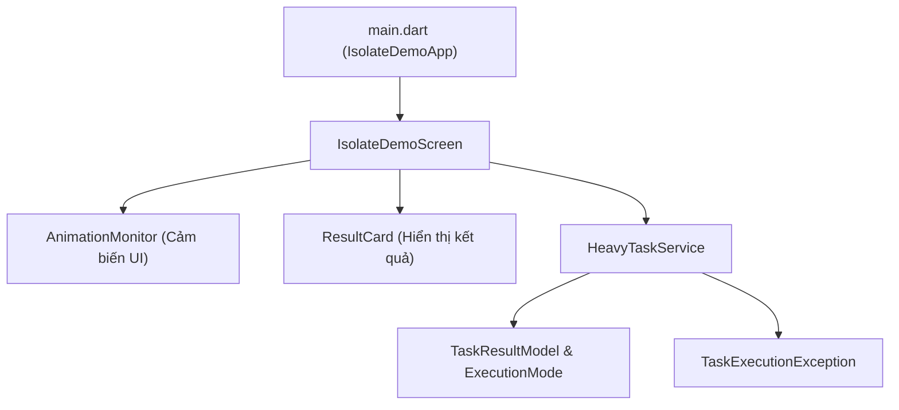
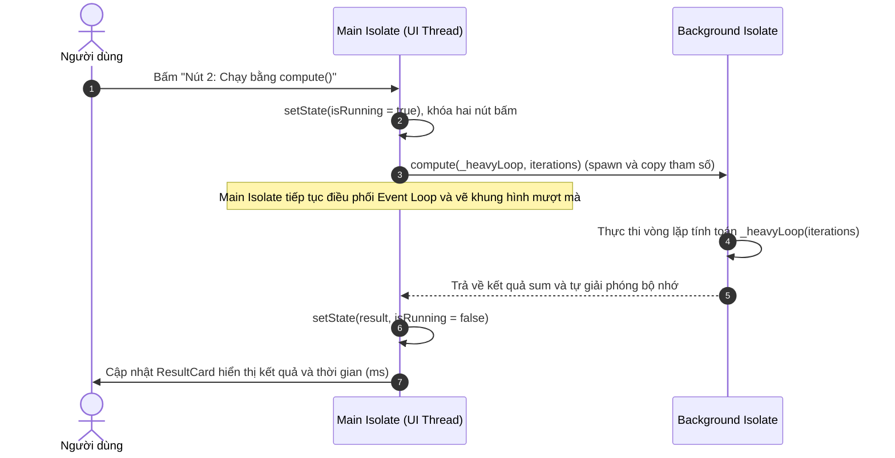

# Xử lý tác vụ nặng với Isolate (hàm compute) để giữ giao diện mượt

## 1. Tiêu đề và giới thiệu

Chủ đề 03: **Xử lý tác vụ nặng với Isolate (hàm compute) để giữ giao diện mượt**.

- Môn học: Lập trình Đa nền tảng
- Đơn vị: Khoa Điện tử và Trí tuệ Nhân tạo, Trường Đại học Bách Khoa – Đại học Đà Nẵng
- Năm học: 2026

Trong các ứng dụng Flutter, giao diện người dùng được dựng và xử lý các sự kiện tương tác trực tiếp trên Main Thread (UI thread). Khi ứng dụng phải thực hiện một tác vụ tính toán nặng (CPU-bound) chạy đồng bộ, Main Thread bị chiếm dụng hoàn toàn khiến chu trình dựng khung hình bị gián đoạn, dẫn tới hiện tượng giật khung hình (UI Jank) hoặc đơ ứng dụng (UI Freeze). Để giải quyết vấn đề này, Dart cung cấp mô hình Isolate hoạt động độc lập và không chia sẻ đối tượng/bộ nhớ với luồng chính. Ứng dụng demo Chủ đề 03 so sánh trực quan giữa việc chạy một tác vụ tính toán trực tiếp trên Main Thread và việc đưa tác vụ đó sang luồng nền thông qua hàm `compute()`, giúp giao diện luôn duy trì trạng thái mượt mà.

Ứng dụng được thiết kế đơn giản với một màn hình duy nhất nhằm tập trung làm rõ bản chất kỹ thuật:
- Sử dụng một tác vụ tính toán CPU-bound nặng dùng chung cho cả hai kịch bản thử nghiệm.
- Cung cấp hai nút bấm để kích hoạt hai chế độ thực thi khác nhau: chạy trực tiếp trên Main Thread và chạy thông qua `compute()`.
- Tích hợp cụm hiệu ứng chuyển động liên tục đóng vai trò là "cảm biến thị giác" giúp người dùng nhận biết ngay lập tức thời điểm luồng giao diện bị khóa cứng hoặc duy trì mượt mà.
- Dự án không sử dụng thư viện bên ngoài, không yêu cầu API key, Firebase hay cấu hình biến môi trường `.env`.

### Mục lục

1. [Tiêu đề và giới thiệu](#1-tiêu-đề-và-giới-thiệu)
2. [Thành viên và phân công (WBS)](#2-thành-viên-và-phân-công-wbs)
3. [Cơ sở lý thuyết tóm tắt](#3-cơ-sở-lý-thuyết-tóm-tắt)
4. [Yêu cầu hệ thống và cài đặt](#4-yêu-cầu-hệ-thống-và-cài-đặt)
5. [Hướng dẫn sử dụng và kịch bản demo](#5-hướng-dẫn-sử-dụng-và-kịch-bản-demo)
6. [Cấu trúc thư mục và kiến trúc](#6-cấu-trúc-thư-mục-và-kiến-trúc)
7. [Giải thích mã nguồn chính](#7-giải-thích-mã-nguồn-chính)
8. [Quyết định thiết kế](#8-quyết-định-thiết-kế)
9. [Kết quả đo](#9-kết-quả-đo)
10. [Quy ước làm việc nhóm với Git](#10-quy-ước-làm-việc-nhóm-với-git)
11. [Xử lý sự cố thường gặp](#11-xử-lý-sự-cố-thường-gặp)
12. [Giới hạn và hướng phát triển](#12-giới-hạn-và-hướng-phát-triển)
13. [Tài liệu tham khảo](#13-tài-liệu-tham-khảo)

---

## 2. Thành viên và phân công (WBS)

| TT | Họ và tên | MSSV | Vai trò | Nội dung phụ trách | Tỷ lệ đóng góp |
| :---: | :--- | :---: | :--- | :--- | :---: |
| 1 | Nguyễn Đức Hải | hainguyen0412 | Business Logic & Lý thuyết | Triển khai `task_execution_exception.dart`, `task_result_model.dart`, `heavy_task_service.dart`; nghiên cứu cơ chế Event Loop, Isolate và hàm `compute()`. | 50% |
| 2 | Phạm Thị Hồng Nhung | 106230021 | UI, State & Demo | Triển khai `isolate_demo_screen.dart`, `animation_monitor.dart`, `result_card.dart`, `main.dart`, tài liệu `README.md`, thực hiện đo đạc và quay video demo. | 50% |

---

## 3. Cơ sở lý thuyết tóm tắt

- **Ngân sách thời gian khung hình (Frame budget):** Để giao diện đạt độ mượt mà, mỗi khung hình phải được hoàn tất trong một khoảng thời gian cố định. Màn hình 60 Hz yêu cầu thời gian dựng tối đa là 16,6 ms mỗi frame; màn hình 120 Hz yêu cầu tối đa 8,3 ms mỗi frame. Nếu thời gian xử lý vượt quá ngân sách, khung hình bị rơi (UI Jank); nếu nhiều khung hình liên tiếp bị bỏ qua, ứng dụng rơi vào trạng thái đứng hình (UI Freeze).
- **Dart đơn luồng và Event Loop:** Mỗi Isolate chạy trên một luồng duy nhất và sở hữu một Event Loop riêng. Event Loop quản lý hai hàng đợi: Microtask queue (ưu tiên cao, chạy trước) và Event queue (xử lý sự kiện cảm ứng, timer, I/O callback, tín hiệu vẽ khung hình vsync). Cơ chế thực thi của Dart là run-to-completion (mỗi tác vụ được chạy liên tục đến khi kết thúc, không bị ngắt quãng giữa chừng).
- **async/await không phải là đa luồng:** Cơ chế `async/await` chỉ thay đổi cách thức chờ đợi tác vụ I/O (mạng, đọc ghi tệp tin) mà không đổi nơi thực thi mã nguồn. Đối với tác vụ tính toán nặng (CPU-bound), mã lệnh đồng bộ vẫn chạy trên luồng hiện tại và chiếm dụng Event Loop, khiến sự kiện vẽ giao diện bị nghẽn.
- **Mô hình Isolate:** Các Isolate trong Dart không chia sẻ đối tượng/bộ nhớ với nhau. Mọi giao tiếp giữa các Isolate bắt buộc phải thông qua cơ chế gửi thông điệp (message passing). Khi một Isolate nền bận tính toán, Isolate chính (UI) vẫn hoàn toàn rảnh rỗi để tiếp tục điều phối Event Loop và vẽ giao diện.
- **Hàm compute():** Là API cấp cao do Flutter cung cấp, giúp đóng gói việc chạy một tác vụ đơn lẻ trên một Isolate nền và tự động dọn dẹp sau khi hoàn thành. Trên các nền tảng native (Android, iOS, Windows, macOS, Linux), `compute()` hoạt động tương đương `Isolate.run()`. Trên nền tảng web, do đặc thù đơn luồng của JavaScript, `compute()` chạy trên cùng Event Loop hiện tại.
- **Chi phí kỹ thuật:** Hàm `compute()` giúp giữ giao diện không bị khóa cứng, nhưng không làm tác vụ tính toán chạy nhanh hơn. Ngược lại, hàm này tốn thêm chi phí tạo isolate (spawn) và chi phí sao chép dữ liệu (copy). Hàm truyền vào `compute()` nên là hàm top-level hoặc static method, và chỉ nhận đúng một tham số.

---

## 4. Yêu cầu hệ thống và cài đặt

### Yêu cầu môi trường

| Thành phần | Yêu cầu tối thiểu | Phiên bản trong dự án | Ghi chú |
| :--- | :--- | :--- | :--- |
| Flutter SDK | >= 3.22 | 3.47.0 (stable) | Mã nguồn sử dụng thuộc tính `surfaceContainerHighest` của Material 3 |
| Dart SDK | >= 3.0 | ^3.13.0 | Cấu hình tại trường `environment.sdk` trong tệp `pubspec.yaml` |
| Thiết bị chạy | Android 5.0+, iOS 12+, Windows 10+ | Thiết bị thật hoặc giả lập | Ưu tiên kiểm thử trên Android, iOS hoặc Windows Desktop |

*Lưu ý:* Dự án là ứng dụng độc lập, không cần cấu hình `.env`, `google-services.json`, API key hay kết nối Firebase.

### Các bước cài đặt và chạy ứng dụng

1. Clone mã nguồn từ kho lưu trữ:
   ```bash
   git clone https://github.com/hainguyen0412/ltdnt_khoi1_cd3.git
   cd lt_dnt_khoi1_cd3
   ```
2. Tải các gói phụ thuộc:
   ```bash
   flutter pub get
   ```
3. Kiểm tra danh sách thiết bị đang kết nối:
   ```bash
   flutter devices
   ```
4. Khởi chạy ứng dụng ở chế độ profile trên thiết bị:
   ```bash
   flutter run --profile -d <device-id>
   ```

### Khởi tạo project từ đầu (nếu repo chỉ có thư mục lib/)

Trong trường hợp tải mã nguồn chỉ có thư mục `lib/` mà chưa có các tệp nền tảng (android, ios, windows...) và `pubspec.yaml`:
```bash
flutter create isolate_compute_demo
cd isolate_compute_demo
# Chép đè toàn bộ thư mục lib/ và file README.md vào project mới
flutter pub get
flutter run --profile
```

### Cảnh báo quan trọng khi chạy

- **Không chạy trên trình duyệt Chrome/Web:** Trên nền tảng web, Flutter biên dịch sang JavaScript đơn luồng. Hàm `compute()` trên web chạy trực tiếp trên Event Loop hiện tại mà không tạo luồng nền mới, do đó cả hai nút bấm đều sẽ gây đơ giao diện như nhau.
- **Nên chạy ở chế độ `--profile` hoặc `--release`:** Không sử dụng chế độ debug (`--debug`) để đo đạc hiệu năng vì trình biên dịch JIT và các cơ chế kiểm tra nội bộ làm tốc độ CPU chậm hơn đáng kể, dẫn đến sai lệch kết quả đo thời gian.

---

## 5. Hướng dẫn sử dụng và kịch bản demo

### Kịch bản thực hiện

1. **Bước 1 (Quan sát trạng thái ban đầu):** Khi mở ứng dụng, quan sát cụm widget `AnimationMonitor` (vòng tròn và thanh chạy) đang chuyển động liên tục và mượt mà.
2. **Bước 2 (Kích hoạt Nút 1 - Main Thread):** Bấm nút màu đỏ `Nút 1: Chạy trên Main Thread (đơ UI)`.
   - *Hiện tượng:* Cụm animation lập tức bị đứng hình hoàn toàn trong khoảng 2-3 giây. Người dùng không thể chạm hay tương tác với màn hình. Sau khi tính toán xong, khung `ResultCard` cập nhật thời gian thực thi.
3. **Bước 3 (Kích hoạt Nút 2 - compute):** Bấm nút màu xanh `Nút 2: Chạy bằng compute() (mượt)`.
   - *Hiện tượng:* Cụm animation tiếp tục chuyển động đều đặn, không hề có hiện tượng khựng hay giật khung hình. Sau khi tính toán xong ở luồng nền, kết quả và thời gian thực thi được cập nhật lên `ResultCard`.

---

## 6. Cấu trúc thư mục và kiến trúc

### Cấu trúc mã nguồn

```text
lib/
├── main.dart                                        # Điểm khởi chạy ứng dụng (IsolateDemoApp)
├── core/
│   └── exceptions/
│       └── task_execution_exception.dart           # Ngoại lệ tuỳ chỉnh cho lỗi thực thi tác vụ
├── models/
│   └── task_result_model.dart                      # Định nghĩa ExecutionMode và TaskResultModel
├── services/
│   └── heavy_task_service.dart                     # Dịch vụ xử lý tác vụ nặng (Main vs compute)
└── ui/
    ├── screens/
    │   └── isolate_demo_screen.dart                # Màn hình chính điều khiển và quản lý trạng thái
    └── widgets/
        ├── animation_monitor.dart                  # Widget kiểm tra độ mượt của khung hình
        └── result_card.dart                        # Widget hiển thị kết quả và thời gian thực thi
```

### Bảng phân công tệp tin

| Tệp tin | Vai trò kỹ thuật | Người phụ trách |
| :--- | :--- | :--- |
| `task_execution_exception.dart` | Định nghĩa class `TaskExecutionException` đóng gói lỗi thực thi | Nguyễn Đức Hải |
| `task_result_model.dart` | Định nghĩa enum `ExecutionMode` và model `TaskResultModel` | Nguyễn Đức Hải |
| `heavy_task_service.dart` | Chứa hàm `_heavyLoop` và phương thức điều phối `run(mode)` | Nguyễn Đức Hải |
| `main.dart` | Cấu hình theme Material 3 và khởi tạo `IsolateDemoApp` | Phạm Thị Hồng Nhung |
| `isolate_demo_screen.dart` | Xây dựng giao diện màn hình, quản lý state và sự kiện bấm nút | Phạm Thị Hồng Nhung |
| `animation_monitor.dart` | Widget chứa progress indicators làm cảm biến kiểm tra frame | Phạm Thị Hồng Nhung |
| `result_card.dart` | Hiển thị 3 trạng thái: chờ tính toán, hoàn thành, thông báo lỗi | Phạm Thị Hồng Nhung |

### Sơ đồ kiến trúc ứng dụng (Flowchart)



### Sơ đồ tuần tự của hàm compute() (Sequence Diagram)



---

## 7. Giải thích mã nguồn chính

### Hàm tác vụ nặng `_heavyLoop`

Được định nghĩa tại `lib/services/heavy_task_service.dart`:

```dart
int _heavyLoop(int iterations) {
  if (iterations <= 0) {
    throw ArgumentError('Số vòng lặp phải lớn hơn 0.');
  }
  var sum = 0;
  for (var i = 0; i < iterations; i++) {
    sum += (i % 7) * (i % 3);
  }
  return sum;
}
```

- **Hàm top-level và đúng một tham số:** Hàm được viết ở phạm vi ngoài cùng của tệp (top-level) và chỉ nhận duy nhất một tham số kiểu `int`. Điều này thỏa mãn yêu cầu bắt buộc của `ComputeCallback` trong hàm `compute()`, tránh việc closure vô tình tham chiếu tới đối tượng giao diện (như `BuildContext` hoặc `this`).
- **Tác vụ CPU-bound thuần túy:** Vòng lặp `for` chạy tuần tự trên CPU mà không có bất kỳ câu lệnh `await` nào. Khi chạy trên Main Isolate, mã này giữ chặt CPU và ngăn chặn Event Loop xử lý các sự kiện tiếp theo.
- **Biểu thức tính toán `(i % 7) * (i % 3)`:** Đảm bảo mỗi vòng lặp đều có thao tác tính toán số học thực tế, ngăn trình biên dịch tối ưu hóa lược bỏ vòng lặp rỗng.

### Phương thức điều phối `HeavyTaskService.run`

Được định nghĩa tại `lib/services/heavy_task_service.dart`:

```dart
Future<TaskResultModel> run(
  ExecutionMode mode, {
  int iterations = defaultIterations,
}) async {
  final stopwatch = Stopwatch()..start();
  try {
    final int sum;
    if (mode == ExecutionMode.mainThread) {
      await Future<void>.delayed(const Duration(milliseconds: 50));
      sum = _heavyLoop(iterations);
    } else {
      sum = await compute(_heavyLoop, iterations);
    }
    stopwatch.stop();
    return TaskResultModel(
      mode: mode,
      sum: sum,
      durationMs: stopwatch.elapsedMilliseconds,
    );
  } catch (e) {
    stopwatch.stop();
    throw TaskExecutionException('Lỗi khi chạy qua ${mode.label}', e);
  }
}
```

- **`Future.delayed(50 ms)` ở nhánh Main Thread:** Trước khi gọi `_heavyLoop` đồng bộ trên luồng chính, cần nhường quyền cho Event Loop một khoảng thời gian ngắn để giao diện kịp dựng lại trạng thái "Đang tính toán..." và vô hiệu hóa nút bấm trước khi luồng chính bị đóng băng.
- **`compute(_heavyLoop, iterations)` ở nhánh Isolate:** Flutter tự động tạo một Isolate nền mới, sao chép giá trị `iterations` sang, gọi hàm `_heavyLoop`, chuyển kết quả `sum` ngược lại Main Isolate và tự động thu hồi Isolate nền.
- **Đo thời gian bằng `Stopwatch`:** Đồng hồ bấm giờ đo toàn bộ khoảng thời gian thực tế (`elapsedMilliseconds`). Ở nhánh `compute()`, thời gian này bao gồm cả chi phí tạo isolate và chi phí sao chép thông điệp.
- **Bọc ngoại lệ thống nhất:** Khối `try/catch` bắt mọi lỗi (kể cả trường hợp Isolate nền ném lỗi) và đóng gói lại thành `TaskExecutionException` để UI xử lý an toàn.

### Cảm biến giao diện `AnimationMonitor` và xử lý trạng thái `_handleRun`

- **Cảm biến khung hình `AnimationMonitor`:** Widget chứa `CircularProgressIndicator` và `LinearProgressIndicator`. Các widget này dựa vào xung nhịp `vsync` từ Ticker để vẽ lại mỗi khung hình (mỗi 16,6 ms). Nếu luồng chính bị nghẽn bởi tác vụ đồng bộ, Ticker không thể kích hoạt vẽ khung hình mới khiến animation lập tức bị đứng.
- **Phương thức `_handleRun` trong `IsolateDemoScreen`:**
  - Gọi `setState` cập nhật cờ `_isRunning = true` để khóa cả hai nút bấm, ngăn người dùng bấm nhiều lần gây xung đột.
  - Sử dụng kiểm tra `if (!mounted) return;` trước khi gọi `setState` sau khi hoàn thành tác vụ bất đồng bộ nhằm tránh cập nhật trạng thái khi widget đã bị hủy khỏi cây giao diện.
  - Khối `finally` đảm bảo cờ `_isRunning` luôn được đặt lại thành `false` để mở khóa nút bấm dù tác vụ hoàn thành hay phát sinh lỗi.

---

## 8. Quyết định thiết kế

| Quyết định | Lý do lựa chọn |
| :--- | :--- |
| Hai nút bấm dùng chung một hàm `_heavyLoop` | Đảm bảo khối lượng tính toán hoàn toàn giống nhau, tạo điều kiện so sánh công bằng giữa việc chạy trên Main Thread và Isolate. |
| Vòng lặp CPU-bound thuần và chỉ truyền nhận dữ liệu `int` | Tách biệt hoàn toàn chi phí tính toán CPU với chi phí sao chép đối tượng phức tạp, giúp quan sát rõ bản chất nghẽn luồng. |
| Định nghĩa `_heavyLoop` là hàm top-level, một tham số | Tuân thủ quy định chữ ký của `compute()`, ngăn ngừa việc closure tham chiếu đối tượng UI làm phát sinh lỗi truyền thông điệp. |
| Chọn hàm `compute()` thay vì tự cấu hình `Isolate.spawn` | Tác vụ thuộc loại chạy một lần nhận kết quả (one-off task). Hàm `compute()` giúp mã nguồn ngắn gọn, tự động quản lý vòng đời tạo cổng và thu hồi Isolate. |
| Chèn `Future.delayed(50 ms)` trước khi chạy ở Main Thread | Đảm bảo Event Loop kịp hoàn thành lượt vẽ trạng thái "Đang tính toán..." lên màn hình trước khi CPU bị chiếm dụng hoàn toàn. |
| Quản lý trạng thái bằng `setState` | Ứng dụng chỉ có một màn hình với trạng thái cục bộ đơn giản, sử dụng `setState` giúp dự án tinh gọn và không phụ thuộc thư viện ngoài. |

---

## 9. Kết quả đo

### Bảng số liệu thực nghiệm

| Tiêu chí đánh giá | Nút 1: Main Thread (chạy trực tiếp) | Nút 2: Background Isolate (hàm compute) |
| :--- | :---: | :---: |
| Thời gian thực thi (ms) | [__] | [__] |
| Trạng thái vòng quay animation | Đứng hình (UI Freeze) | Chuyển động mượt |
| Biểu đồ khung hình (Performance Overlay) | Vượt ngưỡng 16,6 ms nhiều frame | Duy trì ổn định dưới 16,6 ms |

- Thiết bị thử nghiệm: `[tên thiết bị, ví dụ: Google Pixel 7 / Samsung Galaxy S21 / Windows Desktop]`
- Chế độ chạy: `--profile`
- Số vòng lặp thiết lập: `defaultIterations = 150000000` (150 triệu vòng lặp)

### Hướng dẫn cách đo đạc

1. Khởi động ứng dụng trên thiết bị ở chế độ profile: `flutter run --profile`.
2. Bấm Nút 1 ba lần liên tiếp, ghi lại giá trị thời gian (ms) hiển thị trên `ResultCard`, sau đó lấy giá trị trung bình để điền vào bảng.
3. Bấm Nút 2 ba lần liên tiếp, ghi lại giá trị thời gian (ms), lấy giá trị trung bình để điền vào bảng.
4. Để quan sát biểu đồ khung hình, đổi thuộc tính `showPerformanceOverlay: true` tại `lib/main.dart` và chạy lại ứng dụng để theo dõi các cột đỏ vượt ngưỡng khi bấm Nút 1 so với các cột xanh ổn định khi bấm Nút 2.

### Nhận xét kỹ thuật

Hàm `compute()` không làm cho thuật toán tính toán nhanh hơn; thời gian thực thi của nhánh `compute()` có thể bằng hoặc chênh lệch vài mili-giây so với Main Thread do phát sinh thêm chi phí khởi tạo Isolate và sao chép dữ liệu. Lợi ích then chốt của `compute()` nằm ở việc giải phóng Main Thread, giúp giao diện người dùng luôn phản hồi và không bị gián đoạn chu trình dựng khung hình.

---

## 10. Quy ước làm việc nhóm với Git

### Phân chia nhánh

- `main`: Nhánh chính, chỉ chứa mã nguồn ổn định đã kiểm thử và duyệt qua Pull Request.
- `feat/isolate-logic`: Nhánh làm việc của Thành viên 1 phụ trách logic nghiệp vụ, service, model và exception.
- `feat/ui`: Nhánh làm việc của Thành viên 2 phụ trách giao diện màn hình, widget cảm biến, kết quả và tài liệu.

### Quy ước thông điệp commit (Conventional Commits)

Định dạng thông điệp commit: `<type>(<scope>): <mô tả ngắn>`

Ví dụ commit của Thành viên 1:
```bash
git commit -m "feat(service): add _heavyLoop and HeavyTaskService.run"
git commit -m "feat(models): create TaskResultModel and ExecutionMode enum"
git commit -m "feat(core): implement TaskExecutionException"
```

Ví dụ commit của Thành viên 2:
```bash
git commit -m "feat(ui): add AnimationMonitor widget with progress indicators"
git commit -m "feat(ui): implement ResultCard with three display states"
git commit -m "feat(screen): assemble IsolateDemoScreen and connect to service"
git commit -m "docs: add comprehensive README documentation"
```

### Quy trình tích hợp và lịch sử đóng góp

Mỗi thành viên làm việc trên nhánh tính năng riêng bằng các commit nhỏ có ý nghĩa rõ ràng, sau đó tạo Pull Request về nhánh `main` để thành viên còn lại kiểm duyệt trước khi gộp mã nguồn.

| Thành viên | Nhánh làm việc | Số lượng commit | Nội dung công việc chính |
| :--- | :--- | :---: | :--- |
| Nguyễn Đức Hải | `feat/isolate-logic` | 3 | Triển khai logic tính toán, exception, model |
| Phạm Thị Hồng Nhung | `feat/ui` | 4 | Xây dựng UI, widget cảm biến, test, tài liệu |

---

## 11. Xử lý sự cố thường gặp

| Hiện tượng lỗi | Nguyên nhân | Biện pháp xử lý |
| :--- | :--- | :--- |
| Cả hai nút bấm đều làm đơ giao diện trên trình duyệt Web | Nền tảng web chạy JavaScript đơn luồng, hàm `compute()` chạy trên cùng Event Loop hiện tại mà không tạo luồng mới. | Chuyển sang chạy ứng dụng trên thiết bị thật (Android, iOS) hoặc ứng dụng Windows Desktop (`flutter run -d windows`). |
| Thời gian thực thi đo được rất lớn hoặc giao diện đơ quá lâu | Ứng dụng đang chạy ở chế độ debug (`--debug`), nơi trình biên dịch JIT và assert nội bộ làm giảm tốc độ thực thi. | Khởi chạy ứng dụng ở chế độ profile hoặc release: `flutter run --profile`. |
| Nút 1 bị đơ quá ngắn (dưới 1 giây) hoặc quá lâu (trên 10 giây) | Cấu hình phần cứng CPU của từng thiết bị thử nghiệm khác nhau dẫn đến tốc độ vòng lặp khác nhau. | Mở tệp `lib/services/heavy_task_service.dart`, điều chỉnh hằng số `defaultIterations` tăng hoặc giảm cho phù hợp với thiết bị. |
| Lỗi biên dịch liên quan tới `surfaceContainerHighest` | Thuộc tính này thuộc hệ màu Material 3 được giới thiệu trong các phiên bản Flutter mới. | Nâng cấp Flutter SDK lên phiên bản tối thiểu 3.22 bằng lệnh `flutter upgrade`. |
| Không nhận diện được thiết bị khi chạy lệnh `flutter run` | Chưa bật chế độ USB Debugging trên điện thoại hoặc máy ảo chưa khởi động hoàn tất. | Chạy lệnh `flutter doctor` để kiểm tra kết nối thiết bị và chạy `flutter devices` để lấy đúng ID thiết bị. |

---

## 12. Giới hạn và hướng phát triển

- Ứng dụng hiện tại tập trung minh họa cho một tác vụ CPU-bound tính toán số học cơ bản; chưa triển khai các bài toán thực tế phức tạp hơn như nén ảnh, xử lý âm thanh hay giải mã nhị phân lớn.
- Chưa tích hợp kiểm thử tự động (Integration Test) chuyên sâu để đo đạc biến thiên khung hình tự động trong quá trình chạy tác vụ.
- Có thể mở rộng sử dụng `Isolate.spawn` kết hợp với cặp cổng `ReceivePort` và `SendPort` để duy trì một worker dài hạn (long-running worker) phục vụ cho các tác vụ trao đổi thông điệp hai chiều liên tục.
- Khi cần gọi các plugin hệ thống từ bên trong Isolate nền, cần thiết lập thêm `BackgroundIsolateBinaryMessenger`.

---

## 13. Tài liệu tham khảo

1. Flutter Docs, Concurrency and isolates: https://docs.flutter.dev/perf/isolates
2. Flutter API, compute function: https://api.flutter.dev/flutter/foundation/compute.html
3. Dart Docs, Concurrency in Dart: https://dart.dev/language/concurrency
4. Flutter Docs, Improving rendering performance: https://docs.flutter.dev/perf/rendering-performance
5. Flutter Docs, Flutter's build modes: https://docs.flutter.dev/testing/build-modes
